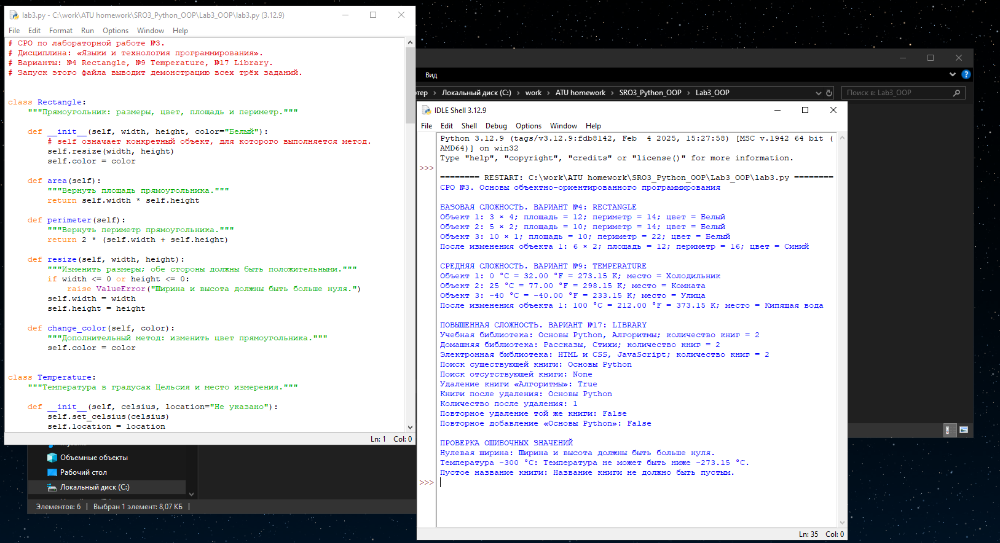

# СРО №3. Основы объектно-ориентированного программирования

Дисциплина: «Языки и технология программирования».

Выполнены три индивидуальных задания из лабораторной работы №3:

| Уровень сложности | Номер варианта | Класс |
| --- | --- | --- |
| Базовый | 4 | Rectangle |
| Средний | 9 | Temperature |
| Повышенный | 17 | Library |

## Цель работы

Освоить создание классов, объектов, конструктора __init__(), атрибутов и методов в Python. Научиться изменять состояние объектов с помощью методов.

## Файлы

- [lab3.py](lab3.py) — полный исходный код трёх заданий и демонстрация работы.
- [results.txt](results.txt) — сохранённый вывод программы.
- README.md — условия, описание решения, тестовые сценарии и объяснения.
- [screenshots/run.png](screenshots/run.png) — реальный запуск программы в IDLE на ПК пользователя.

## Как запустить

Программа использует возможности самого Python. Дополнительные пакеты устанавливать не требуется.

### Через IDLE в Windows

1. Установить Python с официального сайта [python.org](https://www.python.org/downloads/windows/). Обычный установщик включает редактор IDLE.
2. Извлечь папку Lab3_OOP из архива.
3. В меню «Пуск» найти и открыть IDLE.
4. В IDLE выбрать File → Open и открыть файл lab3.py.
5. В окне с кодом выбрать Run → Run Module или нажать F5.
6. Результат появится в окне IDLE Shell. Программа последовательно покажет все три задания.

### Через командную строку

Открыть командную строку в папке Lab3_OOP и выполнить:

```text
python lab3.py
```

## Базовый уровень: вариант №4 — Rectangle

**Условие:** создать класс Rectangle с шириной и высотой; вычислять площадь и периметр.

**Атрибуты:** width — ширина, height — высота, color — дополнительный атрибут цвета.

**Методы:**

- area() возвращает площадь: ширина × высота.
- perimeter() возвращает периметр: 2 × (ширина + высота).
- resize(width, height) изменяет размеры и проверяет положительность сторон.
- change_color(color) — дополнительный метод изменения цвета.

В конструкторе проверка размеров выполняется через resize(). Если хотя бы одна сторона не положительная, возникает ValueError с понятным сообщением.

Созданы три объекта: 3 × 4, 5 × 2 и 10 × 1. У первого объекта затем изменяются размеры на 6 × 2 и цвет на синий.

| Сценарий | Ожидаемый и полученный результат |
| --- | --- |
| Прямоугольник 3 × 4 | Площадь 12, периметр 14 |
| Прямоугольник 5 × 2 | Площадь 10, периметр 14 |
| Прямоугольник 10 × 1 | Площадь 10, периметр 22 |
| Изменение первого объекта на 6 × 2 | Площадь 12, периметр 16 |
| Изменение цвета первого объекта | Атрибут color содержит «Синий» |
| Создание объекта с нулевой шириной | ValueError: стороны должны быть больше нуля |

## Средний уровень: вариант №9 — Temperature

**Условие:** создать класс Temperature, хранящий температуру в °C и преобразующий её в °F и K.

**Атрибуты:** celsius — температура в градусах Цельсия, location — дополнительный атрибут места измерения.

**Методы:**

- to_fahrenheit() вычисляет температуру по формуле F = C × 9 / 5 + 32.
- to_kelvin() вычисляет температуру по формуле K = C + 273.15.
- set_celsius(celsius) изменяет температуру.
- change_location(location) — дополнительный метод изменения места измерения.

set_celsius() проверяет, что температура не ниже абсолютного нуля, -273.15 °C. Результаты в демонстрации отображаются с двумя знаками после десятичной точки.

Созданы три объекта с температурами 0, 25 и -40 °C. У первого объекта затем изменяются температура и место измерения.

| Сценарий | Ожидаемый и полученный результат |
| --- | --- |
| 0 °C | 32 °F и 273.15 K |
| 25 °C | 77 °F и 298.15 K |
| -40 °C | -40 °F и 233.15 K |
| Изменение первого объекта на 100 °C | 212 °F и 373.15 K |
| Изменение места измерения | Атрибут location содержит «Кипящая вода» |
| Значение -300 °C | ValueError: температура ниже абсолютного нуля |

## Повышенный уровень: вариант №17 — Library

**Условие:** создать класс Library с коллекцией книг; реализовать добавление, удаление и поиск по названию.

Книга представлена строкой с её названием. Каждый объект библиотеки хранит собственный список.

**Атрибуты:** books — коллекция названий, name — дополнительный атрибут названия библиотеки.

**Методы:**

- add_book(title) добавляет непустое название и возвращает True. Для уже существующего названия возвращает False.
- remove_book(title) удаляет книгу и возвращает True. Если книги нет, возвращает False.
- find_book(title) выполняет поиск по точному названию и возвращает найденное название или None.
- count_books() — дополнительный метод, возвращающий количество книг.

Пробелы по краям названия удаляются. Поиск учитывает регистр букв. Пустое название вызывает ValueError.

Созданы три объекта: учебная, домашняя и электронная библиотеки. В каждую добавлены две книги. Затем в учебной библиотеке продемонстрированы поиск, удаление и повторные действия.

| Сценарий | Ожидаемый и полученный результат |
| --- | --- |
| Добавление «Основы Python» и «Алгоритмы» | Обе книги добавлены, количество равно 2 |
| Поиск «Основы Python» | Возвращается найденное название |
| Поиск «Неизвестная книга» | Возвращается None |
| Удаление «Алгоритмы» | Возвращается True, количество становится 1 |
| Повторное удаление «Алгоритмы» | Возвращается False, список сохраняется |
| Повторное добавление «Основы Python» | Возвращается False, дубликат не появляется |
| Добавление строки из пробелов | ValueError: название не должно быть пустым |

## Выполнение общих требований

В каждом классе, помимо конструктора, реализованы четыре метода. Для каждого варианта созданы минимум три объекта, показаны вычисления или операции и изменение состояния.

Дополнительное задание выполнено для всех трёх вариантов:

| Класс | Новый атрибут | Новый метод |
| --- | --- | --- |
| Rectangle | color | change_color() |
| Temperature | location | change_location() |
| Library | name | count_books() |

Назначение расширений: хранить цвет фигуры, указывать место измерения температуры и различать библиотеки по имени с подсчётом их книг.

Обязательные операции из условий реализованы отдельными методами. В показанных сценариях состояние объектов меняется через эти методы. Закрытые атрибуты в выбранных вариантах не предписаны.

## Как устроен код

Сначала описаны три класса. Затем функции demo_rectangle(), demo_temperature() и demo_library() создают объекты и показывают их работу. Функция demo_invalid_values() демонстрирует обработку ошибок.

main() запускает все демонстрации. Условие if __name__ == "__main__" позволяет выполнять их при запуске файла и не выполнять при импорте классов в другую программу.

Ошибки перехватываются конструкцией try/except, поэтому сообщение об ошибочном сценарии выводится, а выполнение демонстрации продолжается.

## Пояснения для защиты

- **Класс** — описание объектов с одинаковой структурой и поведением. Например, Rectangle описывает прямоугольники.
- **Объект** — конкретный экземпляр класса. Rectangle(3, 4) создаёт один прямоугольник с заданными сторонами.
- **Атрибут** — данные объекта. Например, width хранит ширину конкретного прямоугольника.
- **Метод** — функция, описанная в классе и работающая с объектом. Например, resize() меняет размеры.
- **__init__()** выполняет начальную настройку объекта после его создания.
- **self** — ссылка на тот объект, для которого вызван метод. Поэтому self.width относится к его ширине.
- **return** возвращает результат вызвавшему коду; print() показывает информацию на экране.
- **True и False** — логические значения «истина» и «ложь». В Library они показывают, выполнено ли действие.
- **None** означает отсутствие найденного результата.
- **Инкапсуляция** объединяет состояние объекта и операции с ним. Методы позволяют проверять изменение данных, например запрещать неположительные стороны.
- Имя атрибута вида **__balance** вызывает преобразование имени Python (name mangling), затрудняя случайное обращение извне. Это не абсолютный запрет доступа.

## Проверка на ПК и скриншот

Программа запущена на ПК пользователя через IDLE в Python 3.12.9. В окне Shell показаны результаты всех трёх вариантов, изменения состояния объектов и обработанные ошибочные значения. После завершения появилось приглашение `>>>`. Сообщения о нулевой ширине, температуре -300 °C и пустом названии относятся к специально проверяемым ошибочным сценариям, которые перехвачены программой.



## Результаты и вывод

Вывод реального запуска сохранён в [results.txt](results.txt). Для каждого варианта представлены не менее трёх тестовых сценариев.

Дополнительно выполнены 22 проверки ожидаемых значений, ошибочных изменений и независимости коллекций разных библиотек. Проверка проведена в Python 3.12.14; сам код использует обычные классы, списки, условия и функции Python 3.

В результате созданы три класса, реализованы их атрибуты и методы, выполнены преобразования и операции с коллекцией. Показано изменение состояния объектов, обработка ошибочных значений и выполнение дополнительного задания для каждого варианта.
