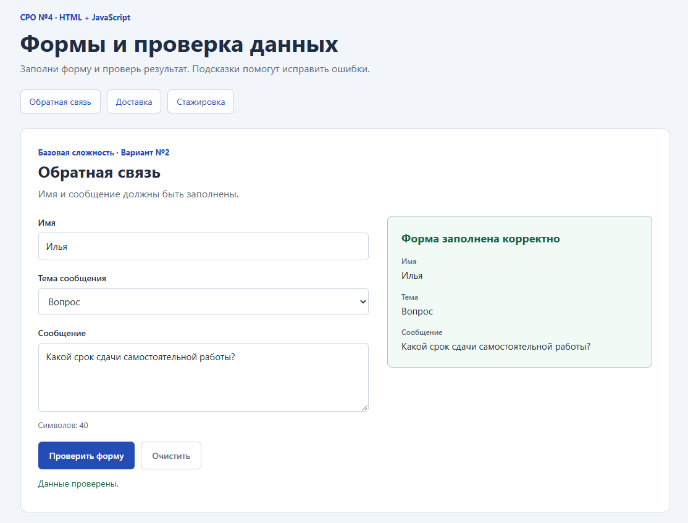
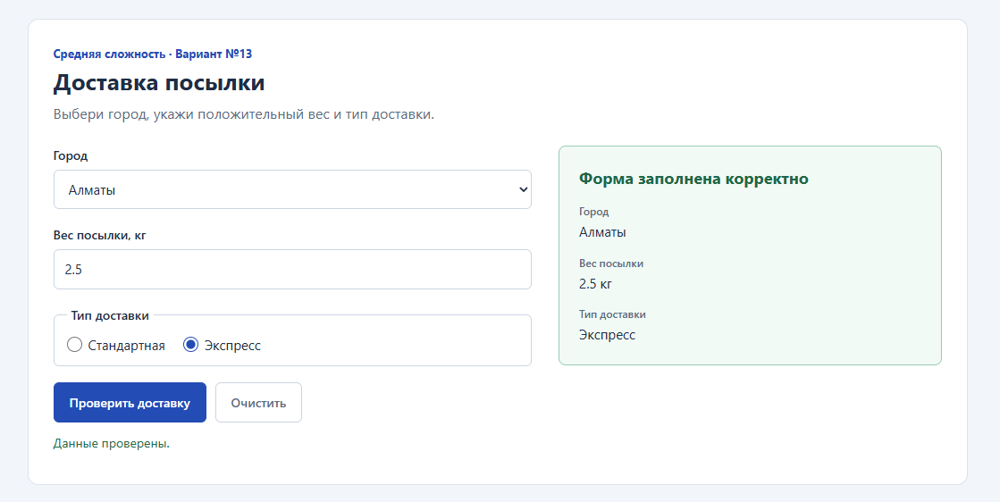
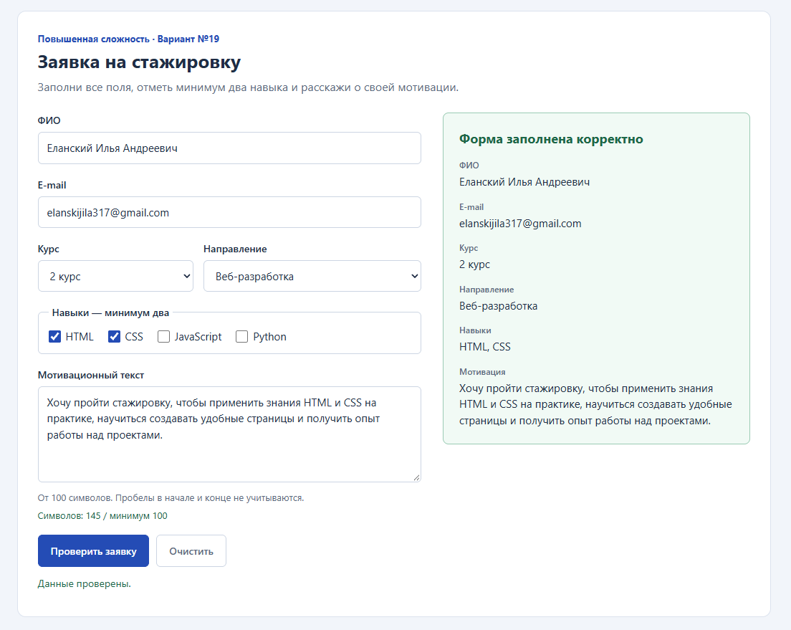

# СРО по лабораторной работе №4

**Дисциплина:** «Языки и технология программирования».  
**Тема:** формы и валидация на стороне клиента (HTML + JavaScript).

## Цель работы

Создать формы с текстовыми и числовыми полями, списками, переключателями и флажками. Проверять данные с помощью JavaScript, показывать понятные ошибки и выводить результат успешной проверки на странице.

## Выполненные варианты

| Сложность | Вариант | Условие |
| --- | --- | --- |
| Базовая | №2 | Обратная связь: имя, тема сообщения (select), текст сообщения. Имя и сообщение не должны быть пустыми. |
| Средняя | №13 | Доставка: город, вес посылки, тип доставки. Проверить положительный вес и вывести выбранные данные. |
| Повышенная | №19 | Заявка на стажировку: ФИО, e-mail, курс, направление, навыки (checkbox), мотивационный текст. Проверить минимум два навыка и длину текста. |

В условии №19 точная минимальная длина текста не указана. В этой реализации выбран минимум **100 символов после удаления пробелов по краям**. Значение задано в константе `MIN_MOTIVATION_LENGTH` в `script.js`.

Все три задания расположены на одной странице. Каждая форма имеет собственный обработчик и результат.

## Файлы и исходный код

| Файл | Назначение |
| --- | --- |
| [index.html](index.html) | Структура страницы, три формы, подписи полей и области для ошибок и результатов. |
| [style.css](style.css) | Цвета, размеры, расположение форм и оформление ошибок. |
| [script.js](script.js) | Проверки, обработчики событий, счётчики и вывод результатов. |
| [README.md](README.md) | Этот отчёт, инструкция запуска и объяснение кода. |
| `screenshots/` | Три реальных скриншота страницы, открытой в Chrome на ПК пользователя. |

Исходный код представлен полностью в трёх отдельных файлах по ссылкам выше. При размещении папки на GitHub каждый файл можно открыть и посмотреть его содержимое.

## Как запустить на Windows

1. Распаковать архив в отдельную папку, например `C:\work\ATU homework\SRO4_HTML_JS`.
2. Открыть вложенную папку `Lab4`.
3. Дважды нажать на `index.html`. При скрытых расширениях файл может называться `index`.
4. Если Windows предлагает выбрать программу, выбрать Chrome или Microsoft Edge.
5. Заполнять формы и нажимать кнопки проверки. Кнопки сверху перемещают к нужному заданию.

Все четыре файла нужно хранить вместе в папке `Lab4`. Дополнительные программы, Python и подключение к интернету для запуска этой страницы не нужны.

## Элементы форм и правила проверки

### 1. Обратная связь

- `input type="text"` — имя.
- `select` — тема: вопрос, предложение или отзыв.
- `textarea` — сообщение.
- Имя и сообщение проверяются после `trim()`. Пустая строка и строка только из пробелов отклоняются.
- После успешной проверки справа показываются имя, тема и сообщение.

Пример корректного ввода: имя «Илья», тема «Вопрос», сообщение «Когда состоится консультация по лабораторной работе?».

### 2. Доставка

- `select` — город.
- `input type="number"` — вес в килограммах. Дробные значения разрешены.
- Два `radio` с одинаковым `name` — стандартная или экспресс-доставка. Выбирается один вариант.
- Город и тип доставки должны быть выбраны.
- Вес должен быть числом больше нуля. Пустое поле, ноль и отрицательное значение отклоняются.
- После успешной проверки показываются город, вес и тип доставки.

Пример корректного ввода: Алматы, 2.5 кг, экспресс-доставка.

### 3. Стажировка

- Текстовое поле — ФИО; `input type="email"` — e-mail.
- Два списка `select` — курс и направление.
- Четыре `checkbox` — HTML, CSS, JavaScript и Python. Можно отметить несколько вариантов.
- `textarea` — мотивация.
- ФИО должно быть непустым, e-mail должен соответствовать простому формату `name@example.com`.
- Курс и направление обязательны; навыков должно быть не менее двух.
- Мотивация должна содержать минимум 100 символов после `trim()`.
- Все обнаруженные ошибки показываются рядом с соответствующими полями.

Пример для проверки: ФИО «Иван Иванов Иванович», e-mail `ivan@example.com`, 2 курс, веб-разработка, навыки HTML и CSS. Это демонстрационные данные.

Пример мотивационного текста:

> Хочу пройти стажировку, чтобы применить знания HTML и CSS на практике, научиться создавать удобные страницы и получить опыт работы над проектами.

## Как работает JavaScript

1. `document.getElementById(...)` находит форму или поле по уникальному `id`.
2. `addEventListener('submit', ...)` связывает отправку формы с функцией проверки.
3. `event.preventDefault()` отменяет обычную отправку формы.
4. `.value` получает введённую строку или выбранный пункт списка.
5. `.trim()` удаляет пробелы в начале и конце строки.
6. Условия `if` обнаруживают неправильные значения. Переменная `isValid` хранит общий результат.
7. `showError()` выводит пояснение рядом с полем и устанавливает `aria-invalid="true"`. CSS выделяет такое поле красным.
8. Если данные правильные, `showResult()` создаёт элементы списка и выводит введённые значения через `textContent`.

В начале каждой повторной проверки старые ошибки и результат очищаются. Поэтому после исправления поля остаются только актуальные сообщения.

Для веса используется `Number(...)` и проверка `Number.isFinite(...)`. Для radio и checkbox используется селектор `:checked`. Количество выбранных навыков получается из массива отмеченных checkbox.

Формы имеют атрибут `novalidate`: он позволяет обработчику JavaScript выполнять проверки и показывать собственные сообщения.

## Дополнительное творческое задание

Добавлены счётчики символов для сообщения и мотивационного текста. Обработчик события `input` обновляет длину после каждого изменения. При достижении 100 символов счётчик мотивации меняет цвет на зелёный.

Также добавлены выделение ошибочных полей и кнопки «Очистить». Обработчик `reset` очищает сообщения и результат, затем обновляет счётчики после стандартного сброса значений формы.

## Результаты проверок

Выполнены **33 проверки**, успешно: **33**. Среда: Node.js v24.19.0, jsdom 30.1.2.

Проверки выполнены на фактическом HTML и JavaScript в DOM-среде jsdom. Они проверяют значения, обработку `submit`, сообщения об ошибках, итоговые данные и сброс. Дополнительно на ПК пользователя в Chrome подтверждены запуск страницы, отображение всех трёх форм и успешная проверка заполненных данных каждой формы. Эти три успешных сценария представлены на реальных скриншотах ниже. Отправка клавишей Enter и мобильная ширина отдельно не проверены.

| № | Раздел | Проверка и ожидаемое поведение | Результат |
| --- | --- | --- | --- |
| 1 | Структура | Три формы, уникальные id, подписи полей и подключения CSS/JS | Пройдено |
| 2 | Обратная связь | Корректные данные; пробелы по краям удалены | Пройдено |
| 3 | Обратная связь | Пустое имя отклонено | Пройдено |
| 4 | Обратная связь | Пустое сообщение отклонено | Пройдено |
| 5 | Обратная связь | Имя и сообщение из пробелов отклонены | Пройдено |
| 6 | Обратная связь | Выбранная тема выводится; стандартная отправка отменена | Пройдено |
| 7 | Обратная связь | HTML в сообщении выводится обычным текстом | Пройдено |
| 8 | Обратная связь | Очистка сбрасывает поля, результат, ошибки и счётчик | Пройдено |
| 9 | Обратная связь | Исправление имени убирает ошибку и даёт успешный результат | Пройдено |
| 10 | Доставка | Дробный вес 2.5 кг принят, выбранные данные выведены | Пройдено |
| 11 | Доставка | Нулевой вес отклонён | Пройдено |
| 12 | Доставка | Отрицательный вес отклонён | Пройдено |
| 13 | Доставка | Без города показана ошибка | Пройдено |
| 14 | Доставка | Без типа доставки показана ошибка | Пройдено |
| 15 | Доставка | Пустой вес отклонён | Пройдено |
| 16 | Доставка | Положительный вес 0.001 кг и стандартная доставка приняты | Пройдено |
| 17 | Доставка | Очистка снимает radio и сбрасывает город и вес | Пройдено |
| 18 | Доставка | После успешного ввода ошибочный вес убирает старый результат | Пройдено |
| 19 | Стажировка | Корректная заявка с двумя навыками принята | Пройдено |
| 20 | Стажировка | Один навык отклонён | Пройдено |
| 21 | Стажировка | Ноль навыков отклонён | Пройдено |
| 22 | Стажировка | Мотивация из 99 символов отклонена | Пройдено |
| 23 | Стажировка | Мотивация ровно из 100 символов принята | Пройдено |
| 24 | Стажировка | Некорректный e-mail отклонён | Пройдено |
| 25 | Стажировка | Пустой e-mail отклонён | Пройдено |
| 26 | Стажировка | Без курса показана ошибка | Пройдено |
| 27 | Стажировка | Без направления показана ошибка | Пройдено |
| 28 | Стажировка | ФИО из пробелов отклонено | Пройдено |
| 29 | Стажировка | Пробелы по краям не обходят ограничение длины | Пройдено |
| 30 | Стажировка | Пустая заявка показывает шесть ошибок | Пройдено |
| 31 | Стажировка | Счётчик обновляется при вводе и меняет цвет на границе 100 | Пройдено |
| 32 | Стажировка | Очистка снимает checkbox, сбрасывает счётчик и ошибки | Пройдено |
| 33 | Стажировка | Все четыре навыка допускаются | Пройдено |

## Проверка в браузере и скриншоты

Добавлены три скриншота реальной страницы, открытой на ПК пользователя в Chrome.

### Обратная связь: успешная проверка

Введены имя «Илья», тема «Вопрос», сообщение «Какой срок сдачи самостоятельной работы?». Справа показаны введённые данные и сообщение «Форма заполнена корректно». Счётчик показывает 40 символов.

### Доставка: успешная проверка

Выбраны Алматы, вес 2.5 кг и тип доставки «Экспресс». Справа показаны все три значения и сообщение «Форма заполнена корректно».

### Стажировка: успешная проверка

Заполнены ФИО и e-mail, выбраны 2 курс, направление «Веб-разработка» и навыки HTML и CSS. Мотивационный текст содержит 145 символов при минимуме 100. Справа показаны данные заявки и сообщение «Форма заполнена корректно». Для этой проверки пользователь ввёл свои ФИО и e-mail.

### Дополнительная проверка на ПК

Следующие шаги позволяют проверить поведение форм в настоящем браузере. Их выполнение не подтверждается приведёнными выше скриншотами.

1. Нажать «Проверить форму» в пустой форме обратной связи: должны появиться ошибки имени и сообщения.
2. Заполнить имя и сообщение, повторить проверку: должны появиться итоговые данные, ошибки должны исчезнуть.
3. Проверить доставку: вес 0 отклоняется, вес 2.5 с выбранными городом и типом доставки принимается.
4. Проверить стажировку: один навык или короткая мотивация отклоняются; два навыка и текст от 100 символов принимаются при заполненных остальных полях.
5. Нажать «Очистить»: значения, результаты, ошибки и счётчики должны вернуться в исходное состояние.
6. Ввести корректные данные в обратную связь и нажать Enter в поле имени: результат должен появиться без перезагрузки страницы.

При необходимости можно дополнить отчёт скриншотами сообщений об ошибках.

## Ответы на контрольные вопросы

1. **Что такое HTML-форма?** Набор элементов страницы для ввода и выбора данных, объединённых элементом `<form>`.
2. **Для чего нужны input, select и button?** `input` вводит значение или задаёт выбор, `select` выбирает пункт списка, `button` запускает действие. Кнопка с `type="submit"` отправляет форму.
3. **Чем checkbox отличается от radio?** Несколько checkbox могут быть отмечены одновременно. У radio с одинаковым `name` выбирается только один вариант.
4. **Что такое клиентская валидация?** Проверка данных в браузере пользователя до отправки.
5. **Для чего событие submit?** Оно позволяет обработать отправку всей формы, в том числе при использовании кнопки отправки.
6. **Что делает preventDefault()?** Отменяет стандартное действие события. Для формы это её обычная отправка.
7. **Как получить текст поля?** Через свойство `.value`, например `document.getElementById('feedback-name').value`.
8. **Как проверить checkbox?** Через `.checked`. Все отмеченные флажки можно получить селектором `input[name="skills"]:checked`.
9. **Как получить выбранный пункт select?** Через `.value` найденного элемента списка.
10. **Почему нужны проверки на сервере?** Клиентский код можно изменить или обойти. В реальном приложении сервер самостоятельно проверяет принятые данные.
11. **Каким должно быть сообщение об ошибке?** Оно должно назвать проблему и способ исправления: например, «Отметь минимум два навыка».
12. **Какие случаи проверять?** Корректный ввод, пустые строки, одни пробелы, неверный e-mail, нулевые и отрицательные числа, недостаточный выбор, границу длины текста и исправление ошибки.

## Вывод

Реализованы три формы разных уровней сложности. JavaScript проверяет обязательные поля, положительный вес, формат e-mail, число навыков и длину мотивации. Добавлены счётчики символов, сообщения об ошибках и вывод введённых данных. Структура и обработчики прошли автоматические проверки в DOM-среде. На ПК пользователя в Chrome подтверждены отображение трёх форм и успешная проверка заполненных данных каждой формы. Все три скриншота результатов включены в отчёт; дополнительные проверки в настоящем браузере перечислены отдельно.
