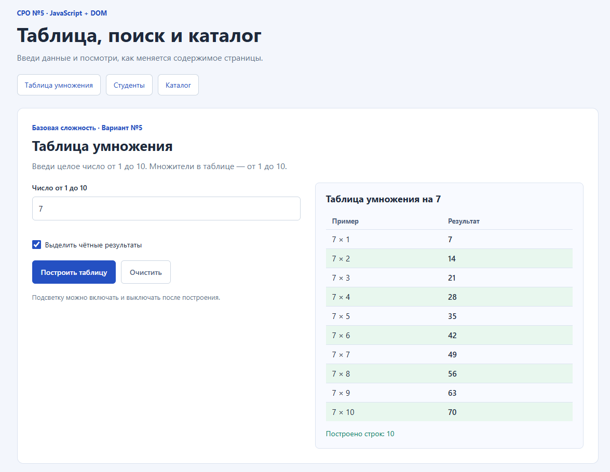
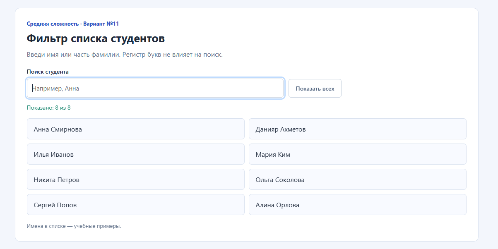
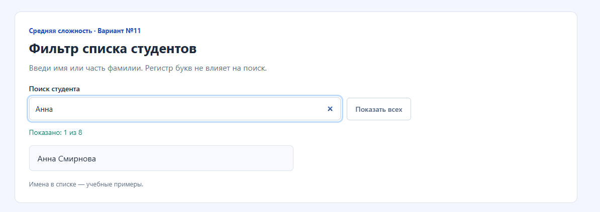
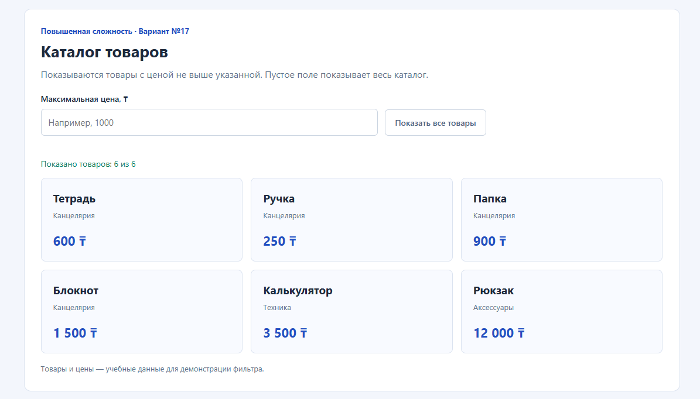
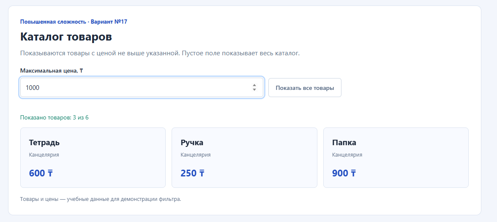

# СРО по лабораторной работе №5

**Дисциплина:** «Языки и технология программирования».  
**Тема:** основы JavaScript в браузере: переменные, условия, циклы, функции и DOM.

## Цель работы

Научиться получать данные из элементов страницы, выполнять вычисления, использовать условия и циклы, создавать элементы DOM и обрабатывать действия пользователя.

## Выполненные варианты

| Сложность | Вариант | Условие |
| --- | --- | --- |
| Базовая | №5 | Таблица умножения для введённого числа от 1 до 10 с использованием цикла. |
| Средняя | №11 | Фильтр списка студентов: ввод строки поиска должен скрывать неподходящие элементы списка. |
| Повышенная | №17 | Каталог товаров из массива объектов: вывести карточки товаров циклом, добавить фильтр по максимальной цене. |

Все три задания находятся на одной странице. Имена студентов, названия товаров и цены используются как учебные данные, а не сведения о реальных людях и магазинах.

Для таблицы принимается целое число от 1 до 10 включительно. Для фильтра каталога принимается максимальная цена от 0 и выше, включая дробные значения; пустое поле снимает ограничение.

## Файлы и исходный код

| Файл | Назначение |
| --- | --- |
| [index.html](index.html) | Разметка трёх заданий, поля, кнопки и области результатов. |
| [style.css](style.css) | Оформление страницы, таблицы, списка и карточек. |
| [script.js](script.js) | Вычисления, фильтры, циклы, функции и обработчики событий. |
| [README.md](README.md) | Отчёт, объяснение кода и инструкция запуска. |
| `screenshots/` | Пять реальных скриншотов интерфейса и результатов на ПК пользователя. |

Полный HTML-код и JavaScript-код находятся в отдельных файлах по ссылкам выше. После загрузки папки на GitHub каждый файл можно открыть для проверки.

## Как запустить на Windows

1. Распаковать архив `SRO5_JavaScript_DOM.zip` в папку, например `C:\work\ATU homework`.
2. Открыть полученную папку `Lab5`.
3. Дважды нажать на `index.html`. Если расширения скрыты, файл может называться `index`.
4. Открыть страницу в Chrome или Microsoft Edge.
5. Переключаться между заданиями с помощью ссылок сверху.

Файлы `index.html`, `style.css` и `script.js` должны оставаться вместе в папке `Lab5`. Для работы страницы не нужны Python, сервер или интернет: JavaScript выполняется браузером.

## Алгоритмы

### 1. Таблица умножения

1. Пользователь вводит число и нажимает «Построить таблицу».
2. Событие `submit` вызывает обработчик; `preventDefault()` отменяет обычную отправку формы.
3. Значение преобразуется функцией `Number(...)`. Проверяется, что поле непустое, число целое и находится в диапазоне 1–10.
4. При ошибке выводится пояснение и выделяется поле. При правильном вводе вызывается `buildMultiplicationTable(number)`.
5. Цикл `for` меняет множитель от 1 до 10. В каждой итерации вычисляется произведение и создаётся строка таблицы.
6. Показываются таблица, её заголовок и число построенных строк.

При изменении введённого числа прежняя таблица убирается, чтобы результат не относился к другому значению. Повторное построение заменяет строки, а не добавляет их к старым.

Пример для числа 7: первая строка — `7 × 1 = 7`, седьмая — `7 × 7 = 49`, последняя — `7 × 10 = 70`.

### 2. Фильтр студентов

1. Событие `input` срабатывает при каждом изменении поля поиска.
2. `trim()` удаляет пробелы по краям, а `toLocaleLowerCase("ru")` переводит запрос в нижний регистр.
3. Цикл `for...of` проходит по элементам списка. Имена тоже переводятся в нижний регистр.
4. Метод `includes(query)` проверяет наличие строки поиска в имени или фамилии.
5. Свойство `hidden` скрывает неподходящие элементы. Они остаются в DOM и могут снова появиться при изменении запроса.
6. Счётчик показывает число совпадений. Если их нет, выводится пояснение.

Пустой запрос или одни пробелы показывают весь список. Поиск `Анна` оставляет «Анна Смирнова», а поиск `сОкОл` — «Ольга Соколова».

### 3. Каталог товаров

1. Массив `products` хранит шесть объектов. Каждый объект содержит название `name`, категорию `category` и цену `price`.
2. При открытии страницы `renderProducts(null)` выводит весь каталог. `null` здесь обозначает отсутствие предела цены.
3. Цикл проходит по массиву. Для подходящего товара `createProductCard(product)` создаёт карточку с названием, категорией и ценой.
4. Событие `input` в поле максимальной цены вызывает `filterProducts()`.
5. Пустое поле возвращает все товары. Отрицательное или неограниченное числовое значение отклоняется.
6. При корректном пределе выводятся товары с условием `product.price <= maxPrice`.
7. Счётчик показывает число подходящих товаров. Если их нет, выводится сообщение.

При пределе 1000 ₸ остаются «Тетрадь» за 600 ₸, «Ручка» за 250 ₸ и «Папка» за 900 ₸. Товар с ценой, равной пределу, включается в результат. Нулевой предел допустим, но для данного массива совпадений нет.

При неправильном вводе прежние карточки убираются и показывается ошибка. После исправления ограничение применяется заново. Все значения выводятся через `textContent`.

## Выполнение общих требований

| Требование | Где выполнено |
| --- | --- |
| Отдельные HTML и JavaScript | `index.html` и `script.js`. |
| Переменные `let` и `const` | `const` хранит ссылки на элементы и массив; `let` используется для множителя и счётчиков. |
| Условия `if/else` | Проверки числа для таблицы и максимальной цены. |
| Минимум один цикл | `for` строит таблицу; `for...of` проходит по студентам и товарам. |
| Пользовательские функции | `buildMultiplicationTable`, `filterStudents`, `createProductCard`, `renderProducts` и другие. |
| Получение элементов через DOM | `getElementById` и `querySelectorAll`. |
| Изменение DOM | Создание строк и карточек, обновление текста, скрытие элементов и переключение класса. |
| Минимум два события | Используются `submit`, `input`, `change` и `click`. |
| Проверка минимум трёх сценариев | Ниже приведены результаты 28 проверок. |

## Дополнительные функции

- **Таблица:** переключаемая подсветка чётных результатов. Она помогает увидеть закономерность: при чётном исходном числе все произведения чётные, при нечётном — чётные и нечётные чередуются. Класс `is-even` добавляется через `classList.toggle(...)`.
- **Студенты:** счётчик совпадений и кнопка «Показать всех». Пользователь видит результат поиска и может быстро вернуть полный список.
- **Каталог:** счётчик показанных товаров и кнопка «Показать все товары». Можно оценить результат фильтра и быстро снять ограничение.

Для таблицы также добавлена кнопка «Очистить», которая сбрасывает поле, результат и сообщения об ошибке.

## Результаты проверок

Выполнены **28 проверок**, успешно: **28**. Среда: Node.js v24.19.0, jsdom 30.1.2.

| № | Раздел | Сценарий | Результат |
| --- | --- | --- | --- |
| 1 | Структура | Уникальные id, подписи полей, локальные подключения CSS и JS | Пройдено |
| 2 | Таблица | Число 7 даёт десять правильных результатов от 7 до 70 | Пройдено |
| 3 | Таблица | Границы 1 и 10 принимаются | Пройдено |
| 4 | Таблица | Пустой ввод отклоняется | Пройдено |
| 5 | Таблица | Ноль отклоняется | Пройдено |
| 6 | Таблица | Число больше 10 отклоняется | Пройдено |
| 7 | Таблица | Отрицательное число отклоняется | Пройдено |
| 8 | Таблица | Дробное число отклоняется | Пройдено |
| 9 | Таблица | Повторное построение заменяет прежнюю таблицу и исправляет ошибку | Пройдено |
| 10 | Таблица | Подсветка чётных результатов переключается событием change | Пройдено |
| 11 | Таблица | Изменение числа убирает результат для предыдущего значения | Пройдено |
| 12 | Таблица | Очистка сбрасывает введённое число, результат, ошибку и подсветку | Пройдено |
| 13 | Студенты | Изначально видны все восемь студентов | Пройдено |
| 14 | Студенты | Имя «Анна» оставляет только Анну Смирнову | Пройдено |
| 15 | Студенты | Поиск части фамилии работает без учёта регистра и пробелов по краям | Пройдено |
| 16 | Студенты | Отсутствие совпадений даёт нулевой счётчик и сообщение | Пройдено |
| 17 | Студенты | Пустой запрос и пробелы возвращают полный список | Пройдено |
| 18 | Студенты | Кнопка «Показать всех» очищает поиск и восстанавливает список | Пройдено |
| 19 | Каталог | Изначально из массива созданы шесть карточек с названием, категорией и ценой | Пройдено |
| 20 | Каталог | Максимальная цена 1000 оставляет три подходящих товара | Пройдено |
| 21 | Каталог | Цена на границе включается, а чуть меньший предел исключает её | Пройдено |
| 22 | Каталог | Нулевой предел допустим и показывает отсутствие подходящих товаров | Пройдено |
| 23 | Каталог | Отрицательная цена показывает ошибку и убирает прежний результат | Пройдено |
| 24 | Каталог | Исправление отрицательной цены убирает ошибку | Пройдено |
| 25 | Каталог | Пустое поле после фильтра или ошибки возвращает все товары | Пройдено |
| 26 | Каталог | Кнопка «Показать все товары» сбрасывает предел и сообщение об отсутствии | Пройдено |
| 27 | Каталог | Большой предел показывает весь каталог | Пройдено |
| 28 | Каталог | Повторное изменение фильтра не дублирует карточки | Пройдено |

Проверки выполнены на фактических файлах `index.html` и `script.js` в DOM-среде jsdom. Проверялись расчёты, границы значений, события, скрытие студентов, состав карточек, счётчики и очистка. Дополнительно пять реальных скриншотов на ПК пользователя подтверждают отображение страницы, правильную таблицу для числа 7, полный и отфильтрованный список студентов, полный каталог и фильтр по цене 1000. Работа на мобильной ширине и отправка формы клавишей Enter отдельно не проверены.

## Проверка на ПК и скриншоты

В отчёт включены пять скриншотов работающей страницы на ПК пользователя.

### Таблица умножения на 7

После ввода 7 и нажатия «Построить таблицу» показаны десять правильных результатов от 7 до 70. Чётные результаты подсвечены. Счётчик показывает 10 построенных строк.

### Студенты: полный список

Пустой запрос показывает все восемь студентов; счётчик — «Показано: 8 из 8».

### Студенты: поиск «Анна»

После ввода «Анна» осталась «Анна Смирнова», остальные элементы скрыты. Счётчик — «Показано: 1 из 8».

### Каталог: все товары

При пустом поле цены видны шесть карточек с названиями, категориями и ценами. Счётчик — «Показано товаров: 6 из 6».

### Каталог: предел 1000

После ввода 1000 видны тетрадь за 600 ₸, ручка за 250 ₸ и папка за 900 ₸. Счётчик — «Показано товаров: 3 из 6».

Дополнительно можно проверить пустое поле таблицы, поиск без совпадений, отрицательную цену и кнопки очистки. Выполнение этих дополнительных сценариев в настоящем браузере не подтверждается представленными скриншотами.

## Объяснение основных конструкций

- **Переменная** хранит значение. `let` допускает присваивание нового значения; `const` запрещает повторное присваивание самой переменной. Содержимое массива или объекта, объявленного через `const`, при этом может изменяться.
- **Условие** выбирает действие. Например, если число вне диапазона — показать ошибку, иначе — построить таблицу.
- **Цикл** повторяет действия. В таблице он создаёт десять строк вместо десяти отдельных фрагментов кода.
- **Функция** объединяет действия под одним именем. Параметр `number` передаёт число в функцию построения таблицы.
- **Массив** — последовательность значений; **объект** — набор свойств. `products` является массивом объектов товаров.
- **DOM** — представление HTML-страницы в виде объектов. JavaScript находит эти объекты, создаёт новые и меняет их свойства.
- **Событие** сообщает о действии пользователя. `addEventListener` связывает событие с функцией-обработчиком.
- **`.value`** получает содержимое поля ввода; **`.textContent`** получает или меняет текст элемента.

## Ответы на контрольные вопросы

1. **Для чего используется JavaScript в браузере?** Для вычислений, обработки действий пользователя и изменения страницы без её перезагрузки.
2. **Чем let отличается от const?** Переменной `let` можно присвоить другое значение; переменной `const` — нельзя. Свойства объекта и элементы массива, заданных через `const`, могут изменяться.
3. **Что такое условный оператор?** Конструкция, которая выбирает выполняемый код в зависимости от условия, например `if/else`.
4. **Какие циклы есть в JavaScript?** В частности, `for`, `while`, `do...while`, `for...of` для значений перебираемых объектов и `for...in` для перечисляемых строковых свойств объекта.
5. **Что такое функция и параметр функции?** Функция — именованный или анонимный блок действий. Параметр — переменная, через которую функция получает переданный аргумент.
6. **Что такое DOM?** Объектное представление структуры документа, с которым может работать JavaScript.
7. **Как получить HTML-элемент?** Например, `document.getElementById("table-number")` или `document.querySelector("#table-number")`.
8. **Чем textContent отличается от value?** `textContent` работает с текстом узла; `value` — с текущим значением элемента формы.
9. **Что такое событие?** Уведомление о действии или изменении, например нажатии кнопки, вводе текста или отправке формы.
10. **Для чего используется addEventListener()?** Для регистрации функции, которая должна выполняться при определённом событии.
11. **Как добавить или удалить CSS-класс?** Через `element.classList.add(...)`, `remove(...)` или `toggle(...)`.
12. **Как создать HTML-элемент средствами DOM?** Через `document.createElement(...)`, затем задать его свойства и добавить в родительский элемент, например методом `append(...)`.
13. **Как перебрать массив циклом?** Например, `for (const product of products)`, где `product` последовательно получает каждый элемент массива.
14. **Почему важна проверка пользовательского ввода?** Она предотвращает неправильные вычисления и помогает пользователю исправить неподходящие значения.
15. **Как разделение HTML и JavaScript улучшает структуру проекта?** Разметка и логика находятся отдельно; проще читать файлы, искать ошибки и менять поведение страницы.

## Вывод

Реализованы таблица умножения, фильтр студентов и каталог товаров. Использованы переменные, условия, циклы, функции, массив объектов, методы DOM и четыре вида событий. Добавлены подсветка чётных результатов, счётчики и кнопки сброса. Все 28 проверок расчётов и обработчиков в DOM-среде пройдены. На ПК пользователя подтверждены отображение страницы, правильная таблица на 7 и работа обоих фильтров; пять скриншотов включены в отчёт.
