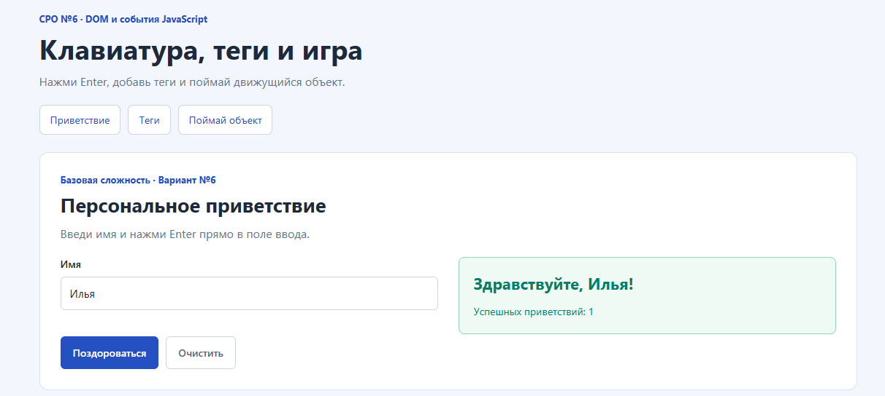
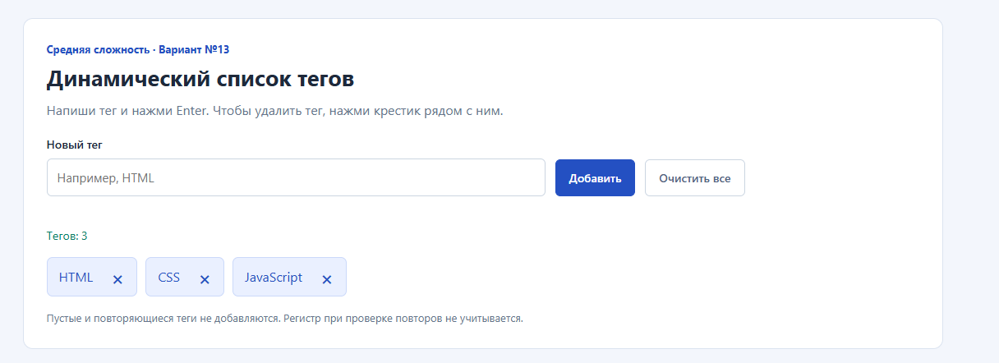
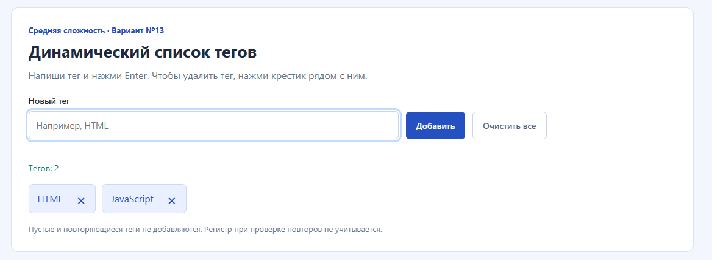
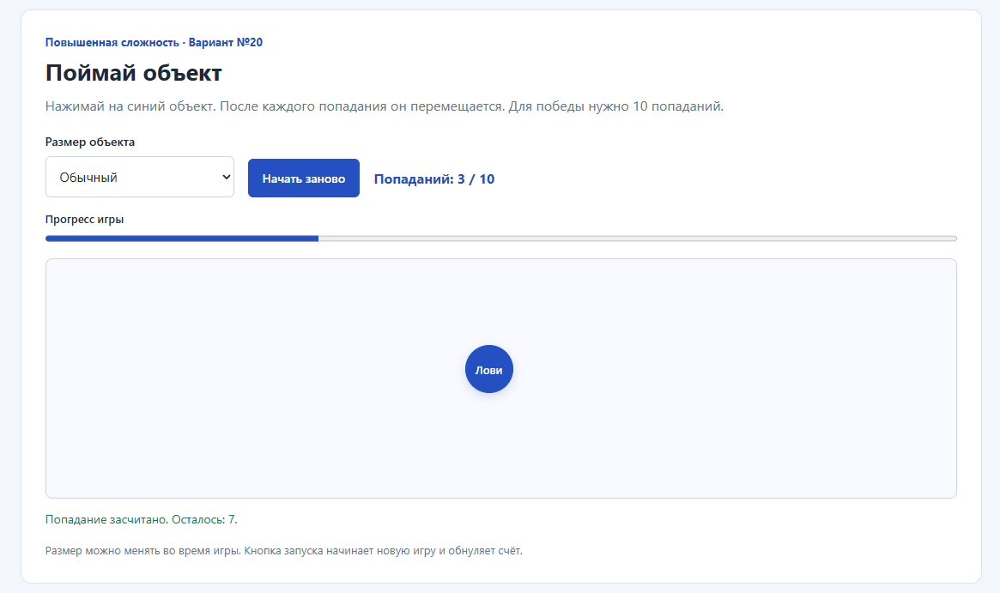
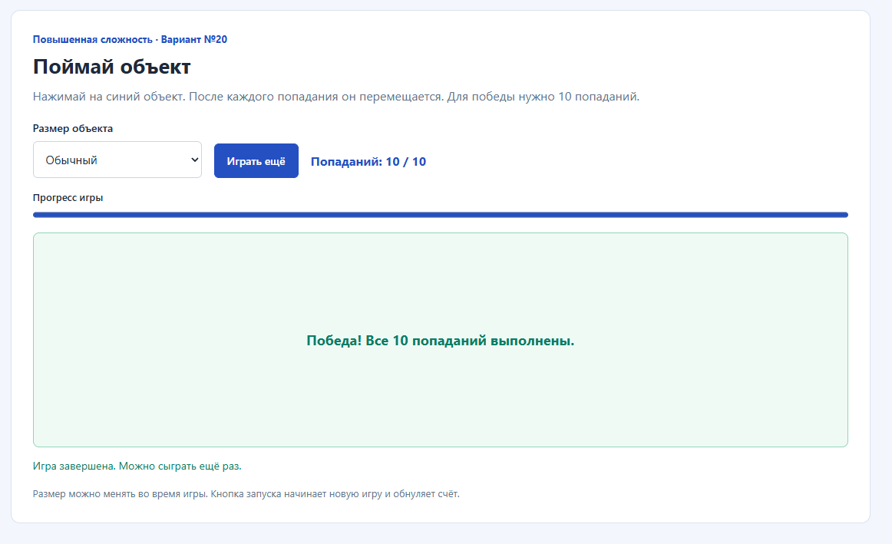

# СРО по лабораторной работе №6

**Дисциплина:** «Языки и технология программирования».  
**Тема:** манипуляции с DOM и события в JavaScript: создание и удаление элементов, обработка мыши и клавиатуры.

## Цель работы

Научиться находить элементы страницы, создавать и удалять их через JavaScript, обрабатывать события клавиатуры и мыши, изменять текст, атрибуты, стили и CSS-классы.

## Выполненные варианты

| Сложность | Вариант | Условие |
| --- | --- | --- |
| Базовая | №6 | Форма ввода имени: по нажатию Enter выводить персональное приветствие на странице. |
| Средняя | №13 | Динамический список тегов: добавление по Enter, удаление по клику на крестик, запрет пустых тегов. |
| Повышенная | №20 | Мини-игра «Поймай объект»: объект случайно меняет положение после клика; считать успешные клики и завершать игру после заданного числа попаданий. |

В условии игры точное число попаданий не задано. В этой реализации выбрана цель **10 попаданий**. Она задана константой `TARGET_HITS`; интерфейс рассчитан на эту цель.

## Файлы и исходный код

| Файл | Назначение |
| --- | --- |
| [index.html](index.html) | Разметка страницы: поля, кнопки, список тегов и игровое поле. |
| [style.css](style.css) | Оформление, расположение блоков, размеры объекта и состояние победы. |
| [script.js](script.js) | Функции и обработчики событий трёх заданий. |
| [README.md](README.md) | Отчёт, инструкция запуска и объяснение кода. |
| `screenshots/` | Пять реальных скриншотов интерфейса и результатов на ПК пользователя. |

Полный исходный код HTML, CSS и JavaScript представлен в отдельных файлах по ссылкам выше. Папка предназначена для размещения на GitHub вместе с отчётом.

## Как запустить на Windows

1. Распаковать `SRO6_DOM_Events.zip` в папку, например `C:\work\ATU homework`.
2. Открыть папку `Lab6_DOM`.
3. Нажать правой кнопкой на `index.html` → «Открыть с помощью» → Google Chrome или Microsoft Edge.
4. Оставить файлы `style.css` и `script.js` рядом с `index.html`.
5. Выбирать задания ссылками сверху.

Страница работает локально в браузере. Установка Python, запуск сервера и подключение к интернету не требуются. Сторонние библиотеки и фреймворки в коде страницы не используются. При обновлении страницы введённые данные и результат игры сбрасываются.

## Интерфейс и алгоритмы

### 1. Персональное приветствие

В разделе находятся поле имени, кнопки «Поздороваться» и «Очистить», результат и счётчик успешных приветствий.

1. Обработчик `keydown` проверяет `event.key`.
2. При Enter отменяется стандартное действие и вызывается `greetUser()`.
3. Имя читается из `.value`, пробелы по краям удаляются через `trim()`.
4. Пустое имя отклоняется. Поле выделяется, рядом появляется пояснение.
5. Для корректного имени выводится `Здравствуйте, Илья!` или другое персональное приветствие.
6. Счётчик увеличивается только после успешного ввода.

Кнопка вызывает ту же функцию через событие `submit`; стандартная отправка формы отменена. При изменении имени прежнее приветствие убирается, чтобы оно не относилось к предыдущему значению. «Очистить» сбрасывает поле, сообщения и счётчик.

Enter во время композиции текста не обрабатывается как команда: проверяется `event.isComposing`.

### 2. Динамические теги

В разделе находятся поле нового тега, кнопки добавления и общей очистки, список тегов и счётчик. Каждый тег содержит текст и крестик удаления.

1. Enter в поле вызывает `addTag()`; кнопка «Добавить» вызывает ту же функцию через `submit`.
2. Пустая строка и строка из пробелов отклоняются.
3. Дополнительно проверяются повторы без учёта регистра. Например, после `HTML` тег `html` не добавляется.
4. Для корректного тега создаются `li`, `span` и `button` через `createElement()`.
5. Текст задаётся через `textContent`; элементы добавляются в список методом `append()`.
6. После добавления поле очищается, обновляется счётчик.
7. Клик по крестику удаляет выбранный `li` методом `remove()`.

Удаление обрабатывает один слушатель `click` на всём списке. Событие от крестика всплывает к списку; `event.target.closest(".tag-remove")` определяет кнопку. Клик по самому тексту тега его не удаляет.

Если тегов не осталось, появляется сообщение пустого списка. «Очистить все» удаляет все элементы, очищает поле и ошибки. Удалённый тег можно добавить повторно.

### 3. Мини-игра «Поймай объект»

В разделе находятся выбор размера, кнопка запуска, счёт, индикатор прогресса и игровое поле.

1. «Начать игру» вызывает `startGame()`: счёт обнуляется, прежний объект удаляется, создаётся одна новая кнопка-объект.
2. Объект получает случайные координаты в пределах поля.
3. Клик по объекту вызывает `registerHit()`, увеличивает счёт и обновляет прогресс.
4. До достижения цели объект перемещается в новое место.
5. Десятое попадание вызывает `finishGame()`: объект удаляется, поле показывает победу, игра прекращает засчитывать попадания.
6. Кнопка «Играть ещё» запускает новую игру с нулевым счётом.

Координата `x` выбирается от 0 до `clientWidth - offsetWidth`, а `y` — от 0 до `clientHeight - offsetHeight`. Размер самого объекта учитывается, чтобы он оставался внутри поля. Если случайные координаты совпали с прежними, одна из координат изменяется на доступное значение. Клик по пустому полю не засчитывается.

При выборе маленького объекта добавляется класс `is-small`: размер меняется с 56 × 56 на 36 × 36 пикселей. Счёт при этом сохраняется. Событие `resize` пересчитывает положение активного объекта при изменении окна.

## Схема «событие → обработчик → изменение DOM»

| Событие | Обработчик | Изменение DOM |
| --- | --- | --- |
| `keydown`, Enter в имени | `greetUser()` | Текст приветствия и счётчик либо ошибка поля. |
| `input` в имени | `clearGreetingMessage()` | Убирает прежнее приветствие и ошибку. |
| `keydown`, Enter в поле тега | `addTag()` | Создаёт `li`, `span`, кнопку и добавляет тег. |
| `click` по крестику тега | Слушатель на `tagList` | Находит и удаляет выбранный `li`, обновляет счётчик. |
| `click` по «Очистить все» | Слушатель кнопки | Удаляет все теги и сбрасывает сообщения. |
| `click` по запуску игры | `startGame()` | Создаёт объект, обнуляет счёт и прогресс. |
| `click` по объекту | `registerHit()` | Меняет счёт и координаты; при цели вызывает завершение. |
| Достижение 10 попаданий | `finishGame()` | Удаляет объект, показывает победу, меняет текст кнопки. |
| `change` размера | Слушатель `targetSize` | Переключает класс `is-small` и пересчитывает положение. |
| `resize` окна | Слушатель на `window` | Перемещает активный объект в пределах нового размера поля. |

## Выполнение обязательных требований

| Требование | Реализация |
| --- | --- |
| Отдельные HTML, CSS и JS | Три файла в папке `Lab6_DOM`. |
| Обращение к DOM | `querySelector()` и `querySelectorAll()`. |
| `addEventListener()` минимум для двух событий | Используются `keydown`, `submit`, `input`, `click`, `change` и `resize`. |
| Создание или удаление элементов | Создание и удаление тегов; создание и удаление игрового объекта. |
| Изменение текста, атрибутов, стиля или класса | `textContent`, `aria-invalid`, координаты `style.left/top`, классы `is-small` и `is-finished`. |
| Понятная реакция на действия | Приветствие, ошибки, счётчики, пустое состояние, прогресс и победа. |
| Без сторонних библиотек | Страница использует только стандартные возможности HTML, CSS и JavaScript. |

## Дополнительные функции

- **Приветствие:** счётчик успешных обращений. Он показывает, сколько раз выполнено действие, и не увеличивается при неправильном вводе.
- **Теги:** запрет повторов без учёта регистра. Он предотвращает появление одинаковых тегов. Также добавлены счётчик и общая очистка.
- **Игра:** выбор размера объекта. Пользователь может усложнить игру без потери счёта. Добавлены индикатор прогресса и повторный запуск.

На защите можно объяснить, что счётчики меняют `textContent`, теги создаются и удаляются через DOM, выбор размера переключает CSS-класс по событию `change`, а координаты объекта меняются по событию `click`.

## Результаты проверок

Выполнены **32 проверки**, успешно: **32**. Среда: Node.js v24.19.0, jsdom 30.1.2.

| № | Раздел | Сценарий | Результат |
| --- | --- | --- | --- |
| 1 | Структура | Уникальные id, подписи полей и локальные файлы без внешних библиотек | Пройдено |
| 2 | Приветствие | Enter выводит приветствие для Ильи и увеличивает счётчик один раз | Пройдено |
| 3 | Приветствие | Пробелы по краям имени удаляются | Пройдено |
| 4 | Приветствие | Пустое имя и одни пробелы отклоняются без увеличения счётчика | Пройдено |
| 5 | Приветствие | Другие клавиши и Enter при композиции текста не запускают приветствие | Пройдено |
| 6 | Приветствие | Отправка формы даёт тот же результат и отменяет перезагрузку | Пройдено |
| 7 | Приветствие | Повторное приветствие накапливает счёт, ошибка не меняет его | Пройдено |
| 8 | Приветствие | Изменение имени убирает устаревший результат, исправление снимает ошибку | Пройдено |
| 9 | Приветствие | Текст с HTML выводится как обычное имя | Пройдено |
| 10 | Приветствие | Очистка сбрасывает поле, результат, ошибку и счётчик | Пройдено |
| 11 | Теги | Enter создаёт один тег HTML с крестиком и очищает поле | Пройдено |
| 12 | Теги | Пустой тег и пробелы не создают DOM-элементы | Пройдено |
| 13 | Теги | Три разных тега добавляются, пробелы по краям удаляются | Пройдено |
| 14 | Теги | Повтор тега запрещён без учёта регистра и пробелов по краям | Пройдено |
| 15 | Теги | Крестик удаляет только выбранный тег | Пройдено |
| 16 | Теги | Удаление последнего тега возвращает сообщение пустого списка | Пройдено |
| 17 | Теги | Клик по тексту тега не удаляет его | Пройдено |
| 18 | Теги | Отправка формы создаёт тег и отменяет стандартную отправку | Пройдено |
| 19 | Теги | HTML внутри тега остаётся обычным текстом | Пройдено |
| 20 | Теги | Очистка удаляет все теги, сбрасывает поле и сообщение об ошибке | Пройдено |
| 21 | Теги | После удаления тот же тег снова можно добавить | Пройдено |
| 22 | Игра | До запуска объекта нет, после запуска создаётся ровно один | Пройдено |
| 23 | Игра | Три попадания увеличивают счёт до 3 и обновляют прогресс | Пройдено |
| 24 | Игра | Клик по игровому полю вне объекта не засчитывается | Пройдено |
| 25 | Игра | После попаданий координаты меняются и остаются в заданных границах | Пройдено |
| 26 | Игра | Совпавшие случайные координаты не оставляют объект на прежнем месте | Пройдено |
| 27 | Игра | Десятое попадание завершает игру, удаляет объект и показывает победу | Пройдено |
| 28 | Игра | Повторный запуск в процессе удаляет старый объект и сбрасывает счёт | Пройдено |
| 29 | Игра | После победы можно начать новую игру без сохранения результата | Пройдено |
| 30 | Игра | Размер выбирается до запуска и меняется во время игры без сброса счёта | Пройдено |
| 31 | Игра | Изменение заданных размеров поля пересчитывает положение объекта | Пройдено |
| 32 | Игра | Пограничное случайное значение оставляет объект целиком внутри поля | Пройдено |

Проверки выполнены в jsdom на фактических HTML и JavaScript. Для клавиатуры создавались события `keydown`, для мыши — события `click`; проверялись изменения DOM, счётчиков и состояний. В тестах координат размеры поля и объекта заданы явно, поскольку jsdom не рассчитывает нативную геометрию страницы. Эти проверки подтверждают алгоритм с заданными размерами, но не внешний вид, реальное расположение объекта или поведение браузера при физических нажатиях клавиш.

jsdom используется только во вспомогательных проверках вне файлов страницы. В поставляемом приложении внешних библиотек нет. Дополнительно скриншоты на ПК пользователя подтверждают отображение страницы, персональное приветствие, добавление трёх тегов, удаление CSS, состояние игры 3 / 10 и завершение при 10 / 10. Они показывают итоговые состояния; само нажатие Enter, режим маленького объекта и мобильная ширина на снимках не зафиксированы.

## Проверка на ПК и скриншоты

В отчёт включены пять скриншотов работающей страницы на ПК пользователя.

### Персональное приветствие

В поле введено «Илья». Показано «Здравствуйте, Илья!»; счётчик успешных приветствий равен 1.

### Добавление тегов

На странице созданы HTML, CSS и JavaScript. У каждого тега есть крестик; счётчик показывает 3.

### Удаление CSS

После удаления CSS остались HTML и JavaScript. Счётчик изменился на 2.

### Игра: три попадания

Счёт равен 3 / 10, прогресс заполнен на 30%, объект находится внутри игрового поля. Сообщение показывает, что осталось 7 попаданий.

### Игра: победа

Счёт равен 10 / 10, прогресс заполнен полностью. Объект удалён, поле показывает «Победа! Все 10 попаданий выполнены», кнопка — «Играть ещё».

Дополнительно можно проверить пустое имя, пустой или повторный тег, маленький размер объекта и повторный запуск игры. Выполнение этих дополнительных сценариев в настоящем браузере не подтверждается представленными скриншотами.

## Ответы на контрольные вопросы

1. **Что такое DOM?** Представление документа как дерева объектов, с которыми может работать JavaScript.
2. **Чем querySelector отличается от querySelectorAll?** Первый возвращает первый подходящий элемент или `null`, второй — список всех подходящих элементов.
3. **Как создать новый элемент?** Через `document.createElement("li")` или другой HTML-тег.
4. **Как добавить созданный элемент на страницу?** Например, методом `parent.append(element)` или `appendChild(element)`.
5. **Как удалить DOM-элемент?** Вызвать `element.remove()`.
6. **Для чего применяется addEventListener?** Для регистрации обработчика определённого события на элементе или другом объекте событий.
7. **Что такое event?** Объект с данными о событии: его типом, источником и другими свойствами.
8. **Как определить нажатую клавишу?** По свойству `event.key`, например сравнить его с `"Enter"`.
9. **Чем click отличается от keydown?** `click` сообщает об активации элемента, а `keydown` — о нажатии клавиши. Кнопка может вызывать `click` и при клавиатурной активации.
10. **Что такое всплытие событий?** Передача события от элемента к его родительским элементам. Это позволяет обрабатывать клики по крестикам одним слушателем на списке тегов.
11. **Для чего используется classList?** Для добавления, удаления и переключения CSS-классов элемента.
12. **Чем textContent отличается от innerHTML?** `textContent` задаёт обычный текст; `innerHTML` разбирает строку как HTML-разметку. В этой работе введённые значения выводятся через `textContent`.
13. **Как изменить атрибут?** Через `setAttribute(...)`, например установить `aria-invalid`, или через соответствующее свойство элемента.
14. **Почему нежелательны одинаковые обработчики в большом количестве?** Они усложняют сопровождение и могут приводить к повторному выполнению действий. Для динамического списка удобно использовать делегирование событий.
15. **Как проверить динамический интерфейс?** Проверить правильный, пустой и повторный ввод, добавление и удаление, значения счётчиков, завершение и повторный запуск, а также реальные действия мышью и клавиатурой.

## Вывод

Реализованы приветствие по Enter, динамические теги и игра «Поймай объект». Использованы обработчики клавиатуры и мыши, создание и удаление DOM-элементов, изменение текста, атрибутов, стилей и классов. Добавлены счётчик приветствий, проверка повторных тегов и выбор размера игрового объекта. Все 32 проверки алгоритмов и состояний в DOM-среде пройдены. На ПК пользователя подтверждены отображение страницы, результат приветствия, создание и удаление тегов, ход игры и победа; пять скриншотов включены в отчёт.
